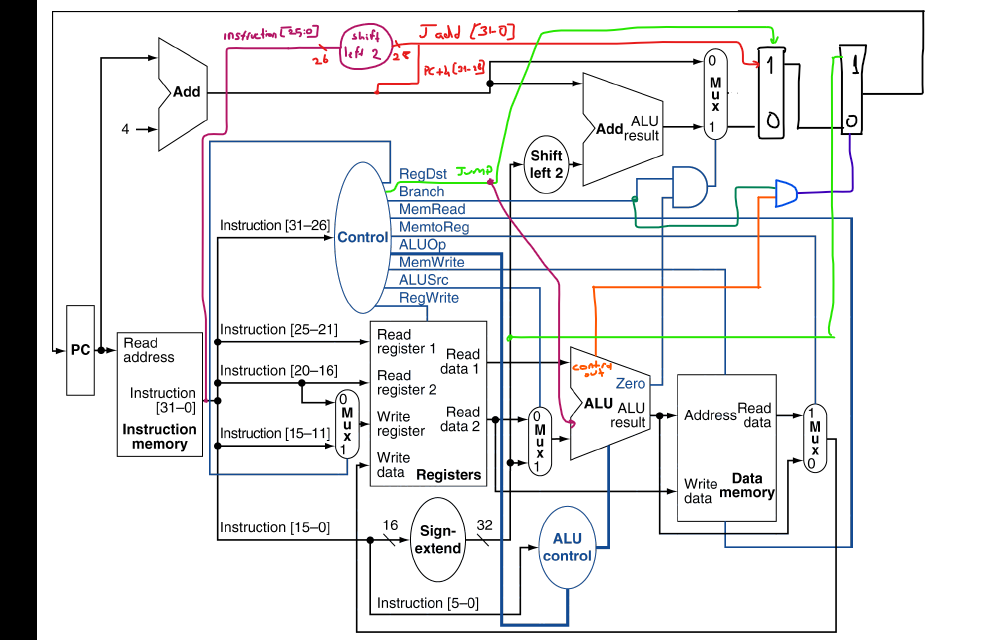

# Extending a Single-Cycle MIPS Processor with Status Flags and Conditional Branches

A processor can add two numbers, but how does it *know* the result was negative, zero, or too big to fit? And how can the next instruction act on that? This project extends a simple single-cycle MIPS processor, written in Verilog and simulated in ModelSim, with a **program status register** and new **conditional branch instructions** that read it, plus three more instructions (`j`, `nor`, `addi`).

## The idea

After every arithmetic instruction, the ALU records three facts about the result in a 3-bit status register (**SVZ**):

| Bit | Flag | Meaning |
|---|---|---|
| 2 | **S**: sign | The result is negative |
| 1 | **V**: overflow | A signed result did not fit in 32 bits |
| 0 | **Z**: zero | The result is zero (already present in the base design) |

**Overflow** is the subtle one. For signed addition it happens exactly when both operands have the same sign and the result has a different sign, for example `0x7FFFFFFF + 1 = 0x80000000`: two positive numbers produced a negative-looking value. The flags are refreshed on every instruction, so the next instruction always sees the status of the previous one.

Two new branch instructions read them:

- **`bvf`**: branch if the previous instruction overflowed (V = 1)
- **`ben`**: branch if the previous result was negative or zero (S = 1 or Z = 1)

Both use a 6-bit opcode (`0x5` for `bvf`, `0x6` for `ben`), 10 unused bits and a 16-bit branch address that is sign-extended.

## Worked examples

```
add $t0, $s1, $s2     s1 = 0x00000003, s2 = 0xFFFFFFFB  ->  t0 = 0xFFFFFFFE
ben label             SVZ = 100 (S = 1)  ->  branch taken

sub $t0, $s1, $s2     s1 = s2 = 3  ->  t0 = 0
ben label             SVZ = 001 (Z = 1)  ->  branch taken

add $t0, $s1, $s2     s1 = 0x7FFFFFFF, s2 = 1  ->  t0 = 0x80000000
bvf label             SVZ = 110 (S = 1, V = 1)  ->  branch taken
```

The same result can be "negative" (S), "zero" (Z) or "wrapped around" (V), and each calls for a different decision, which is why the flags are separate.

## How the hardware changes



The figure is the standard single-cycle MIPS datapath with the additions in colour. Each new instruction touches a different part:

**`j` (jump).** The 26-bit target field is shifted left by two and combined with the upper four bits of the program counter, giving the jump address. A new multiplexer on the PC input selects it when the control unit raises the `jump` flag.

**`nor`.** It is an R-type instruction, so nothing changes until the ALU control unit: a new case for function code `100111` outputs the ALU operation `0101`, and a matching case in the ALU computes the bitwise NOR.

**`addi`.** The control unit recognises its opcode and sets `ALUSrc` and `RegWrite`, so the ALU adds the register and the sign-extended immediate, exactly like the address calculation of loads and stores.

**`ben` and `bvf`.** These needed the most work:

- The ALU operation code grew from 2 to **3 bits**, because the base encoding could not distinguish enough instruction types:

  | Type | ALUOp |
  |---|---|
  | I-type | 000 |
  | R-type | 001 |
  | Branch | 010 |
  | `ben` | 011 |
  | `bvf` | 100 |

  and the ALU control output grew to **4 bits** (`1000` for `ben`, `1001` for `bvf`).
- The ALU computes the flags *per instruction type*, each in its own block. This matters: a NOR of `1` and `1` gives `0`, which must not be flagged as overflow, so one generic overflow formula would be wrong.
- The branch instruction checks the stored flags of the previous instruction and raises a `control_out` signal when its condition holds. A third PC multiplexer is then driven by `branch AND control_out`, choosing between `PC + 4` and the sign-extended branch target.
- The flags are **cleared** after a branch has used them, and also after a jump. A jump does no arithmetic, so without this reset a `bvf` placed right after a `j` would react to stale flags from the instruction before the jump.

**A simulation lesson.** In the first runs each ALU evaluated its inputs twice per cycle (once for its own instruction and once with the next instruction's operands), which corrupted the flags and made `bvf` and `ben` unreliable. Adding a clock-like gate inside the ALU so that each instruction is evaluated exactly once per cycle fixed it.

## Test program and what happens

```
 pc    instruction           effect
0x00   j     label_1         jump to 0x0C
0x04   add   $r4, $r4, $r5   r4 = 0xFFFFFFFF + 0x80000000 = 0x7FFFFFFF  (overflow, V = 1)
0x08   bvf   label_3         V = 1, branch taken to 0x18
0x0C   nor   $r1, $r2, $r3   r1 = ~(0x05 | 0x0A) = 0xFFFFFFF0
0x10   addi  $r4, $r1, 0xF   r4 = 0xFFFFFFFF  (negative, S = 1)
0x14   ben   label_2         S = 1, branch taken back to 0x04
0x18   j     exit            jump to 0x40
```

Execution order is therefore `0x00, 0x0C, 0x10, 0x14, 0x04, 0x08, 0x18, exit`. The simulation waveform shows the program counter following exactly this sequence, and the registers change as expected (`r1 = FFFFFFF0`, then `r4 = FFFFFFFF`, then `r4 = 7FFFFFFF`). Using one program that exercises both branch directions and all five instructions is a good way to test control flow: a wrong flag or a wrong mux input sends the program counter somewhere visibly wrong.

## What you can take from this

1. Control flow in hardware is just data: a few flag bits decide whether the program counter loads a new address.
2. Overflow detection needs the operands' signs, not only the result: the result alone cannot tell whether it wrapped.
3. Extending an existing datapath is mostly about *where the new signals connect*: the ALU, the control unit and the program-counter multiplexer.
4. Timing bugs in simulation (an instruction evaluated twice) are just as real as logic bugs.

## Files

- `source code/`: Verilog modules (`alu32.v`, `alucont.v`, `control.v`, `adder.v`, multiplexers and the top-level processor) with the memory and register initialisation files
